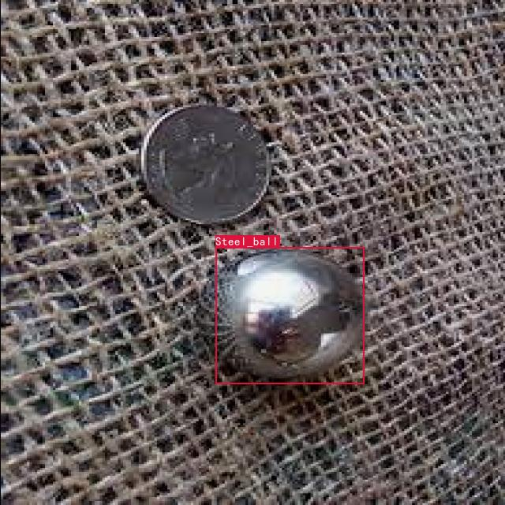
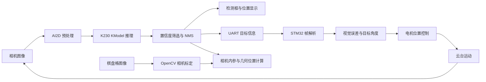

# K230 Vision & Gimbal

面向钢球检测与位置反馈的嵌入式视觉工程，将 K230 端侧检测、相机标定、串口通信与 STM32 云台/电机控制连接起来。



*项目钢球检测输出。*

## 项目简介

### K230 钢球视觉检测与端侧部署

基于 YOLOv5 完成钢球检测，并实现
PyTorch → ONNX → nncase → KModel 的 K230 端侧部署。

- 数据标注与 ROI 处理
- K230 实时推理
- AI2D 预处理对齐
- INT8 量化问题排查
- 视觉坐标与机器人坐标映射

工程同时保留 YOLOv5 416 输入部署、运动目标跟踪、UART 检测输出及 STM32 控制入口。各入口的模型与坐标配置在下文分别列出，便于按任务选用。

## My Contribution

CLGTWDLL 参与以下工作：

- **数据采集**：参与钢球目标图像采集，为检测部署与实验验证提供数据。
- **K230 检测部署**：参与端侧模型部署与运行调试，结合 AI2D 预处理、模型输入输出及检测结果进行联调。
- **视觉与云台/电机联调**：参与 K230 视觉输出与 STM32 控制侧的串口接口联调，协助核对目标位置反馈、控制指令和电机响应。

## 系统流程



| 环节 | 项目源码与资源 |
| --- | --- |
| YOLOv5 416 相机检测 | [`20.Myself/new2/`](20.Myself/new2/)，包含推理脚本、KModel、配置和标签 |
| 运动钢球跟踪 | [`20.Myself/new3/`](20.Myself/new3/)，包含 motion-v3 模型与采样/跟踪脚本 |
| UART 检测输出 | [`det_video_uart_1_3.py`](20.Myself/Test/det_video_uart_1_3.py) 与 [`deploy_config.json`](20.Myself/Test/mp_deployment_source/deploy_config.json) |
| 相机标定 | [`calibrate_camera.py`](20.Myself/new2/calibrate_camera.py) 与 [`camera_calibration.json`](20.Myself/camera_calibration_640/camera_calibration.json) |
| STM32 视觉控制 | [`PTZ_Camera/Core/Src/`](20.Myself/PTZ_Camera/Core/Src/)，包含 `k230_link.c`、`vision_control.c`、`control.c` 和 `motor.c` |
| 几何位置实验 | [`20.Myself/position/`](20.Myself/position/) |

## YOLOv5 → ONNX → nncase → KModel 端侧部署

```text
YOLOv5 / PyTorch 权重
    → 固定输入尺寸的 ONNX
    → nncase + nncase-kpu 的 K230 编译与 PTQ
    → KModel + 部署配置 + 标签
    → K230 AI2D / KPU / 后处理
```

### 1. 导出与转换流程

1. 在与训练权重匹配的 YOLOv5 工作区中导出 ONNX，固定 batch 为 1，并与选用模型的输入尺寸对齐。YOLOv5 的导出入口见 [官方 export.py](https://github.com/ultralytics/yolov5/blob/master/export.py)。
2. 检查 ONNX 的输入布局和输出字段。416 分支对应输入 `[1, 3, 416, 416]`、输出 `[1, 10647, 6]`。
3. 将 ONNX 导入 nncase，目标设为 `k230`，使用与运行环境匹配的 `nncase` 和 `nncase-kpu`，以项目采样图像准备 PTQ 校准输入，完成编译并生成 `.kmodel`。转换接口参考 [Kendryte nncase](https://github.com/kendryte/nncase) 和 [K230 AI 开发文档](https://www.kendryte.com/k230_canmv/en/main/ai_dev_doc.html)。
4. 将 KModel、JSON 配置和标签成套部署；模型路径、输入尺寸、归一化、类别顺序及后处理保持一致。项目已有的接口说明见 [`new2/DEPLOY_NOTES.md`](20.Myself/new2/DEPLOY_NOTES.md)。

上述内容描述工具链流程；本仓库的板端入口、模型和配置使用下列已保存版本。训练权重和外部转换工作区应与这些接口配套。

### 2. 416 分支的模型接口

以下来自 [`new2/k230_deploy_config.json`](20.Myself/new2/k230_deploy_config.json)，是部署配置与张量接口：

| 项目 | 配置 |
| --- | --- |
| 运行时记录 | `nncase_runtime 2.9.0` |
| 模型文件 | `steel_ball_416_nncase_2.9.0.kmodel` |
| 输入 | `[1, 3, 416, 416]`，RGB、NCHW、外部 `float32` |
| 预处理 | 按比例 letterbox，双线性插值，填充 RGB `(114,114,114)`，像素除以 `255.0` |
| 输出 | `[1, 10647, 6]`，`cx, cy, w, h, objectness, Steel_Ball_probability` |
| 检测得分 | `objectness × Steel_Ball_probability` |
| 后处理配置 | 置信度阈值 `0.25`，NMS IoU 阈值 `0.45`，还原 letterbox 坐标 |

PTQ 的内部量化格式与外部输入张量是两个环节：本分支在板端提供 RGB/NCHW/float32 且已除以 255 的输入，AI2D 后的归一化按该接口执行一次。

### 3. 板端运行

416 检测入口按 [`相机部署说明`](20.Myself/new2/相机部署说明.md) 将文件复制至 SD 卡：

```text
/sdcard/
├── main.py                         ← k230_camera_detect_416.py
└── mp_deployment_416/
    ├── k230_deploy_config.json
    ├── labels.txt
    └── steel_ball_416_nncase_2.9.0.kmodel
```

相机 AI 源为 `640×640`，AI2D 缩放至 `416×416` 后构造模型浮点输入；随后筛选预测框、执行 NMS 并绘制结果。输入输出 shape 检查由脚本首帧诊断完成。

运动跟踪入口使用 [`k230_camera_track_motion_v3.py`](20.Myself/new3/k230_camera_track_motion_v3.py) 和配套 motion-v3 模型，其 SD 卡目录依据 [`new3/相机部署说明.md`](20.Myself/new3/相机部署说明.md) 设置。

## 相机标定

使用 `640×640` 棋盘格图像，棋盘格为 **11×8 个内角点**、格长 **15 mm**。流程为图像采集、角点检测、相机内参与畸变参数求解、重投影误差统计。

- K230 采集脚本：[`capture_camera_calibration_640.py`](20.Myself/new2/capture_camera_calibration_640.py)。
- 主机侧求解脚本：[`calibrate_camera.py`](20.Myself/new2/calibrate_camera.py)，依赖 OpenCV 与 NumPy。
- 保存的结果：[`camera_calibration.json`](20.Myself/camera_calibration_640/camera_calibration.json)，包含相机矩阵、畸变系数、逐图角点结果和重投影误差。

在主机 Python 环境中运行：

```bash
python 20.Myself/new2/calibrate_camera.py 20.Myself/camera_calibration_640
```

该命令使用指定目录中的 `calib_*.jpg` 重新求解并保存标定结果。执行前可另存现有 JSON 以便对照。

## 视觉与 STM32 云台/电机联调

UART 联调入口使用 [`Test/det_video_uart_1_3.py`](20.Myself/Test/det_video_uart_1_3.py) 的独立部署包：模型输入 `320×320`，相机 AI 源 `1280×720`，类别为 `Steel_ball`。该分支与上面的 YOLOv5 416 部署包分别按各自配置成套使用。

### K230 侧

- 每帧筛选一个置信度最高的目标，输出框的位置、宽高和类别名。
- 使用 Yahboom `YbProtocol` 生成文本帧，通过 `YbUart(baudrate=115200)` 发送。
- UART 帧结构为：

```text
$length,14,x,y,w,h,class_name#
```

`x,y` 为框左上角，`w,h` 为宽高，均对应 `1280×720` AI 图像坐标。帧长度、功能号与类别名按接收端约定匹配。

### STM32 侧

1. [`k230_link.c`](20.Myself/PTZ_Camera/Core/Src/k230_link.c) 接收 UART 帧，检查长度、功能号、类别名和框边界，并计算目标中心坐标。
2. [`vision_control.c`](20.Myself/PTZ_Camera/Core/Src/vision_control.c) 处理目标时效、滤波与像素误差，将视觉误差映射为电机目标角度。
3. [`control.c`](20.Myself/PTZ_Camera/Core/Src/control.c) 与 [`motor.c`](20.Myself/PTZ_Camera/Core/Src/motor.c) 对接电机位置反馈和控制输出。
4. 通信与控制参数集中在 [`app_config.h`](20.Myself/PTZ_Camera/Core/Inc/app_config.h)；UART 初始化见 [`usart.c`](20.Myself/PTZ_Camera/Core/Src/usart.c)。

联调时依次核对：检测类别与坐标系、串口收发和帧解析、目标角度方向、电机位置反馈及云台响应。板型、引脚与所选固件工程保持对应。

## 实验结果

以下指标直接取自已保存的 [相机标定 JSON](20.Myself/camera_calibration_640/camera_calibration.json)：

| 指标 | 结果 | JSON 字段 |
| --- | ---: | --- |
| 输入图像数 | 30 张 | `input_image_count` |
| 标定成功图像数 | **29 / 30 张** | `successful_image_count` |
| 总重投影 RMS | **0.357 px**（原值 `0.3573903643727539`） | `total_rms_pixels` |
| 平均单图重投影误差 | `0.3450224901 px` | `mean_per_image_reprojection_error_pixels` |
| 图像尺寸 | `640×640 px` | `image_size` |
| 棋盘格 | `11×8` 内角点，`15 mm` 格长 | `board` |

这些数值对应相机标定环节。模型输入尺寸、置信度阈值和 NMS 阈值属于程序配置，分别在部署章节说明。

## 仓库结构与文档入口

```text
README.md
assets/
└── steel-ball-detection.jpg
20.Myself/
├── new/                          YOLOv5 部署资源
├── new2/                         416 检测、图像采集和相机标定脚本
├── new3/                         motion-v3 跟踪与位置采样
├── camera_calibration_640/       标定图像和结果 JSON
├── Test/                         UART 检测输出与独立部署资源
├── position/                     几何位置实验
├── PTZ_Camera/                   STM32 云台/电机工程
└── PTZ_Camera2/                  另一 STM32 控制工程
```

现有工程、模型配置、固件和各目录说明保留原位置及内容；各入口以对应目录中的说明和源文件为准。
